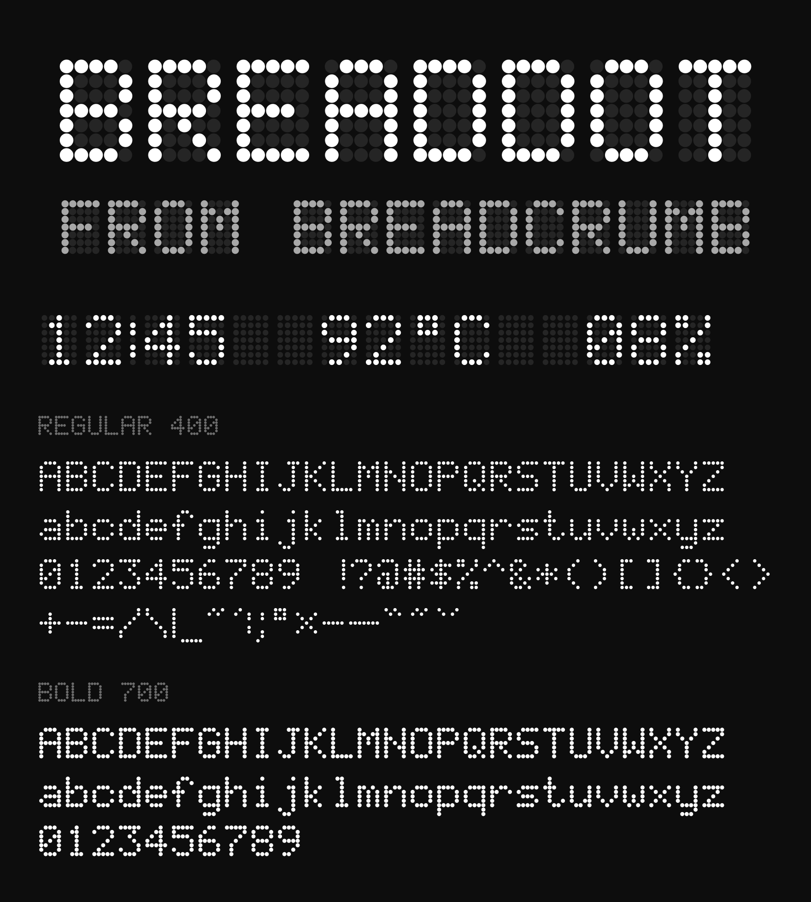

# Breadot

A 5×7 dot-matrix typeface by **[BreadCrumb Studio](https://breadcrumb-studio.com/)**, made for LED boards, status readouts and retro UI.
Free and open source under the [SIL Open Font License 1.1](OFL.txt).

[中文说明](#中文说明)



## Features

- **Real dot grid.** Every glyph sits on a 5×7 grid of round dots, plus 2 rows for descenders. The dot pitch is exactly 1/10 em.
- **Two weights, one width.** Regular 400 and Bold 700 change only the dot size, so switching weight never reflows text. The variable font covers everything in between.
- **Centred in its box.** At 100% line height, caps and figures sit dead centre. At 110%, dot rows line up from one line to the next.
- **Grid base glyphs.** Six extra characters draw the unlit grid, so you can put a dim LED backplate behind text (see [Grid base](#grid-base)).
- **Character set.** All 95 printable ASCII characters, plus `° × ‘ ’ “ ” – — … · •` and 6 grid base glyphs.

## Files

| File | Use |
|---|---|
| `fonts/variable/Breadot.ttf` | Variable font, `wght` 400–700. Recommended for Figma, Sketch and other design apps. |
| `fonts/otf/Breadot-Regular.otf`<br>`fonts/otf/Breadot-Bold.otf` | Static fonts, for apps without variable font support. |
| `fonts/webfonts/Breadot.woff2` | Variable web font. |

Install either the variable font or the static fonts, not both. Otherwise the family shows up twice in font menus.

## Tips

- Use font sizes that are multiples of 10 px (20, 40, 80…). Each dot then lands on whole pixels and stays crisp.
- Cap height is 0.7 em, x-height 0.5 em. A regular glyph is 0.6 em wide. Narrow punctuation is 0.2 or 0.3 em wide.

## Grid base

Put a second text layer of base glyphs **under** your text, with the same font, size, line height and position. Then lower its opacity. Each base glyph matches the width of the characters it sits under:

| 7 rows | 9 rows (with descenders) | Width | Use under |
|---|---|---|---|
| `█` U+2588 | `▓` U+2593 | 5 columns | Letters, figures, space and most punctuation |
| `▌` U+258C | `▒` U+2592 | 2 columns | `, ; ‘ ’ •` |
| `▏` U+258F | `░` U+2591 | 1 column | `: . ! ' \| ·` |

Use the 9-row set when the text has descenders (`g j p q y , ;`). The em dash `—` is 7 columns wide. `█▏` matches its width, but one of its dots falls in the gap between the two base glyphs.

```
text   12:45  Typography
base   ██▏██  ▓▓▓▓▓▓▓▓▓▓
```

**Typing them on macOS:** open the Character Viewer (⌃⌘Space) and search for "block" or "shade". Or switch to the Unicode Hex Input keyboard and hold ⌥ while typing `2588`.

**Stylistic set `ss01`:** in apps that support stylistic sets, `ss01` swaps `█ ▌ ▏` for the 9-row `▓ ▒ ░`.

**On the web:**

```html
<span class="board">
  <span class="base" aria-hidden="true">██▏██</span>
  <span class="text">12:45</span>
</span>
```

```css
@font-face {
  font-family: "Breadot";
  src: url("Breadot.woff2") format("woff2");
  font-weight: 400 700;
}
.board { position: relative; display: inline-block; font: 700 40px/1 "Breadot"; color: #f5b841; }
.board .base { position: absolute; inset: 0; opacity: 0.15; }
.board .text { position: relative; }
```

## Building from source

Each glyph is written as rows of `#` (lit) and `.` (unlit) in the `GLYPHS` table in [`sources/build_font.py`](sources/build_font.py). Edit the table, then rebuild:

```bash
pip install -r sources/requirements.txt
python sources/build_font.py      # → fonts/otf/
python sources/build_variable.py  # → fonts/variable/ + fonts/webfonts/
```

## License

Copyright 2026 BreadCrumb Studio. Licensed under the [SIL Open Font License 1.1](OFL.txt).
You can use Breadot for free in personal and commercial work, embed it in apps and websites, and modify it. The one restriction is that you can't sell the font files on their own.

---

## 中文说明

Breadot 是 **[BreadCrumb Studio](https://breadcrumb-studio.com/)** 出品的 5×7 圆点点阵字体，适合 LED 屏、状态读数和复古界面。按 [SIL OFL 1.1](OFL.txt) 免费开源。

### 特点

- **真实点阵**：每个字形都落在 5×7 圆点网格上，另有 2 行降部。点距正好是 1/10 em。
- **两个字重，同一字宽**：Regular 400 和 Bold 700 只改变圆点大小，切换字重不会重排。可变字体覆盖两者之间的所有字重。
- **字框内居中**：行高 100% 时，大写字母和数字在字框里上下居中；行高 110% 时，多行之间的点阵上下对齐。
- **底格字符**：额外的 6 个字符画出未点亮的网格，可以垫在文字下方做暗色点阵底。
- **字符集**：全部 95 个 ASCII 可打印字符，加上 `° × ‘ ’ “ ” – — … · •` 和 6 个底格字符。

### 文件

- `fonts/variable/Breadot.ttf`：可变字体，wght 400–700，推荐在 Figma 等设计软件里使用。
- `fonts/otf/`：Regular 和 Bold 静态字体，给不支持可变字体的软件用。
- `fonts/webfonts/Breadot.woff2`：网页用的可变字体。

可变字体和静态字体二选一安装，否则字体菜单里会出现两个 Breadot。

### 使用建议

- 字号用 10 px 的倍数（20、40、80…），圆点会落在整像素上，边缘清晰。
- 大写高 0.7 em，x 高 0.5 em；常规字宽 0.6 em，窄标点 0.2 或 0.3 em。

### 底格用法

在文字图层**下方**叠一层底格字符：字体、字号、行高和位置都与文字图层相同，再调低透明度。底格字符的宽度与上方字符一一对应：

| 7 行 | 9 行（含降部） | 宽度 | 垫在哪些字符下 |
|---|---|---|---|
| `█` | `▓` | 5 列 | 字母、数字、空格和大部分标点 |
| `▌` | `▒` | 2 列 | `, ; ‘ ’ •` |
| `▏` | `░` | 1 列 | `: . ! ' \| ·` |

文字带降部（`g j p q y , ;`）时用 9 行底格。长破折号 `—` 宽 7 列，下面垫 `█▏` 宽度一致，但它有一个点会落在两个底格之间的空隙里。

**macOS 输入方法**：打开字符检视器（⌃⌘空格），搜索 "block" 或 "shade"；或者切换到“Unicode 十六进制输入”，按住 ⌥ 输入 `2588`。

**样式集 ss01**：在支持样式集的软件里，打开 ss01 后 `█ ▌ ▏` 会自动换成 9 行的 `▓ ▒ ░`。

### 许可

Copyright 2026 BreadCrumb Studio，按 [SIL Open Font License 1.1](OFL.txt) 授权。个人和商业项目都可以免费使用，也可以嵌入 App 和网页、修改字体；唯一的限制是不能单独售卖字体文件。
